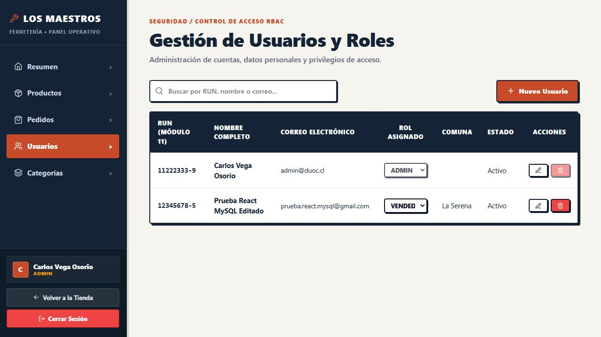
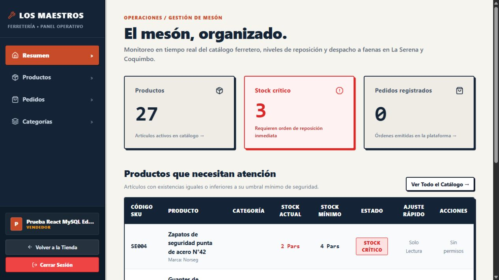
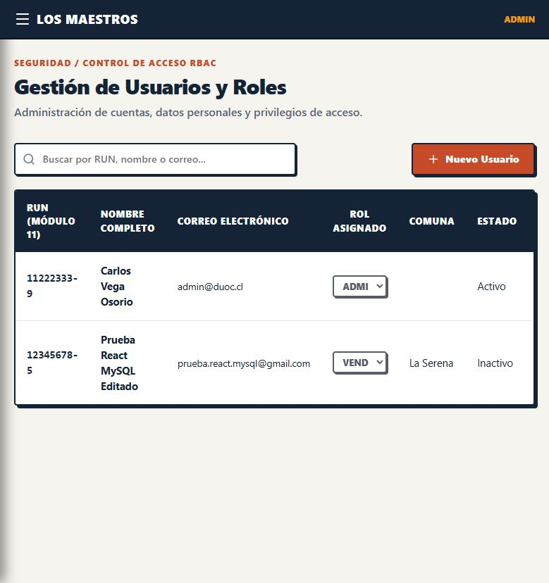

# Pruebas de React con Usuarios y MySQL

La integración final de catálogo, pedidos, crédito y las correcciones de interfaz se documentan en [APIs e integración de fase 3](../../docs/APIs%20e%20Integracion/APIS_E_INTEGRACION.md). Este registro conserva los casos comprobados en la etapa indicada.

**Fecha de verificación** 5 de noviembre de 2026.

Se verificó desde el navegador el flujo de Usuarios, desde el registro hasta la desactivación, utilizando React, Spring Boot y la base MySQL del proyecto.

## 1. Entorno y datos de prueba

| Componente | Dirección o configuración |
| --- | --- |
| React y Vite | `http://localhost:5173` |
| Usuarios | `http://localhost:8081`, perfil `mysql` |
| Ventas | `http://localhost:8082`, perfil `mysql` |
| MySQL | 8.4.13, publicado en `localhost:3307` |
| Cuenta administrativa | `admin@duoc.cl`, creada mediante la configuración del entorno |
| Cuenta ficticia utilizada | `prueba.react.mysql@gmail.com`, RUN `12345678-5` |

La cuenta ficticia se registró como CLIENTE. El administrador editó sus apellidos y cambió su rol a VENDEDOR. Al terminar la prueba se desactivó. Los valores de esa cuenta identifican el caso registrado, y cada reproducción puede utilizar otros datos de prueba válidos.

La [guía del backend](../backend/README.md) explica la preparación de MySQL y los servicios. La [guía del frontend](../frontend/README.md) contiene los comandos de Vite.

## 2. Casos ejecutados

| Caso | Acción desde React | Resultado observado |
| --- | --- | --- |
| Registro | Completar `/registro` con un cliente válido. | Cuenta creada, sesión iniciada y usuario visible en el mantenedor administrativo. |
| Normalización | Ingresar el RUN como `123456785`. | Se guardó como `12345678-5`. |
| Restauración de sesión | Recargar la página con la sesión iniciada. | React consultó el perfil y conservó el acceso. |
| Permisos de cliente | Navegar directamente a `/admin/usuarios`. | Redirección a la tienda. |
| Login administrativo | Iniciar sesión como ADMIN. | Acceso al mantenedor de usuarios. |
| Edición | Cambiar los apellidos, dejando vacía la nueva contraseña. | Actualización confirmada y contraseña anterior conservada. |
| Rol | Cambiar CLIENTE por VENDEDOR desde la tabla. | El nuevo rol apareció después de confirmar la API. |
| Reinicio | Reiniciar Usuarios y recargar React. | Perfil editado y rol conservados en MySQL. |
| Servicio temporalmente caído | Recargar durante el reinicio y pulsar Reintentar al recuperarse. | Error visible durante la interrupción y restauración posterior de la sesión. |
| Permisos de vendedor | Iniciar sesión con la cuenta cuyo rol cambió. | Catálogo en modo Solo Lectura y acceso a Usuarios bloqueado. |
| Desactivación | Desactivar la cuenta desde el mantenedor. | Estado Inactivo y controles de edición de la fila deshabilitados. |
| Cuenta desactivada | Cerrar la sesión administrativa e intentar otro login con la cuenta de prueba. | Mensaje Credenciales inválidas. |

Una consulta SQL a `usuarios` confirmó el perfil editado, el rol VENDEDOR y `activo=0`. El [resultado de esa consulta](evidencias/martin/estado-usuario-prueba.txt) está incluido como evidencia.

## 3. Evidencias de la interfaz

### Figura 1. Persistencia después del reinicio

El mantenedor volvió a cargar el usuario con sus apellidos editados y el rol asignado después de reiniciar Usuarios.

### Figura 2. Panel del vendedor

El vendedor accede a la consulta de catálogo con indicadores de Solo Lectura. La opción de Usuarios se muestra al administrador.

### Figura 3. Cuenta desactivada

El listado conserva el perfil con estado Inactivo. Un nuevo intento de login de esa cuenta fue rechazado.

## 4. Reproducción

1. Preparar el entorno según el [README del backend](../backend/README.md) e iniciar ambos servicios con el perfil `mysql`.
2. Ejecutar `npm ci` y `npm run dev` desde `Fase 3/frontend`.
3. Registrar un cliente en `/registro` usando un RUN válido y correo disponibles.
4. Recargar y comprobar la sesión. Intentar entrar a `/admin/usuarios` como cliente.
5. Cerrar sesión e ingresar como ADMIN. Abrir Usuarios y editar la cuenta registrada.
6. Cambiar su rol a VENDEDOR y reiniciar el proceso de Usuarios. Recargar el mantenedor.
7. Iniciar sesión con la cuenta editada y comprobar los permisos de vendedor.
8. Volver a ingresar como ADMIN, desactivar la cuenta y confirmar el estado en el listado.
9. Cerrar sesión y comprobar el rechazo del login de la cuenta desactivada.

El apellido editado puede usarse como marca de verificación para distinguir datos guardados en el servidor de los datos anteriores del formulario.

## 5. Ajuste y comprobaciones complementarias

Durante el recorrido se detectó un rótulo deshabilitado de Usuarios (Admin) visible para el vendedor. Se retiró para que la opción aparezca exclusivamente al administrador. La [prueba de permisos del catálogo](../frontend/src/test/services/catalogoJeremyFase3.test.jsx) verifica su ausencia y que ese perfil no solicite el listado de usuarios.

En esta comprobación inicial aprobaron 111 pruebas de React en 18 archivos. La compilación de producción terminó correctamente. Oxlint registró cero errores y ocho advertencias de efectos y exportaciones de contextos. Los [resultados de esta ejecución](evidencias/martin/resultados-automaticos.txt) conservan esos contadores históricos. La revisión integrada posterior registra 118 pruebas y se documenta en los [resultados de fase 3](../../docs/APIs%20e%20Integracion/evidencias/resultados-automaticos-v3.txt).

## 6. Alcance

Este recorrido cubre la integración inicial de Usuarios desde React con MySQL. La conexión posterior de catálogo, checkout, historial y cuenta corriente con Ventas ya está completada y se describe en [APIs e integración de fase 3](../../docs/APIs%20e%20Integracion/APIS_E_INTEGRACION.md). La verificación de las transacciones de Ventas se conserva en [Pruebas MySQL](PRUEBAS_MYSQL.md).
