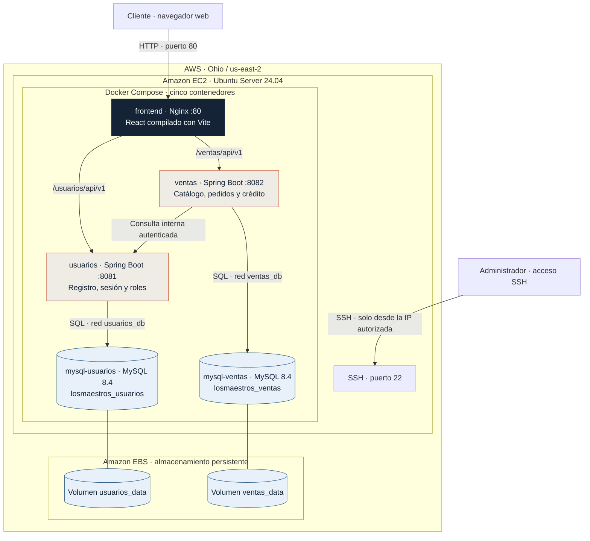

# Ferretería Los Maestros

Aplicación académica de comercio y gestión para una ferretería de La Serena, desarrollada para **Full Stack 2 (DSY1104), Duoc UC**, con el profesor **Hernán Saavedra**.

**Equipo:** Martín Caviedes, Jeremy Hanglin y Sebastián Diaz.

La versión actual está en **Fase 3**: frontend React, dos API REST Spring Boot y persistencia MySQL. El equipo ha desplegado el proyecto en AWS. La configuración reproducible de EC2, Docker Compose y Nginx está incluida en el repositorio.

## Despliegue en AWS

La aplicación se aloja en **una instancia Amazon EC2**. Docker Compose organiza cinco contenedores: el frontend servido por Nginx, dos API Spring Boot y dos servidores MySQL. El navegador accede a una única dirección pública; Nginx entrega React y dirige las peticiones a cada API por la red Docker.

**Cómo se conectan los servicios.** React llama a `/usuarios/api/v1` y `/ventas/api/v1` desde el mismo origen público. Nginx reenvía esas rutas a los puertos internos 8081 y 8082. Usuarios firma los JWT con su clave privada y Ventas los valida con la pública; la consulta interna de Ventas a Usuarios utiliza una credencial compartida y su ruta se bloquea en Nginx.

**Acceso y datos.** El grupo de seguridad permite HTTP para la tienda y restringe SSH a la IP administradora. Las APIs y MySQL no publican puertos en el host. Cada base utiliza una red Docker interna y un volumen propio en el disco EBS; los datos sobreviven a la recreación de contenedores y a la detención de EC2. Los volúmenes no sustituyen un respaldo fuera de la instancia.

**Arranque y operación.** La unidad `losmaestros.service` inicia el conjunto al encender EC2. Su script consulta la IPv4 pública mediante IMDSv2, actualiza el origen permitido y espera los controles de salud de Compose. Así se conserva la configuración cuando AWS asigna otra IP, sin reconstruir React ni regenerar claves.

El despliegue verificado el **7 de noviembre de 2026** utilizó una `m7i-flex.large` (2 vCPU, 8 GiB de RAM) y EBS gp3 cifrado de 30 GiB. El diagrama representa esa variante **HTTP de demostración**. La guía incluye HTTPS opcional con Caddy y un dominio; esa variante agrega un sexto contenedor. Todos los servicios dependen de una sola EC2: al detenerla, la tienda deja de estar disponible.

Consultar la [guía de despliegue y operación](<Fase 3/despliegue/README.md>), la [configuración Docker Compose](<Fase 3/despliegue/compose.yaml>) y la [verificación registrada en EC2](<Fase 3/despliegue/VERIFICACION_EC2.md>). Esta última documenta el ensayo realizado; no indica la disponibilidad actual del servidor.

## Qué permite hacer

- Consultar catálogo, categorías, ofertas y fichas de productos; preparar el carrito.
- Registrarse, iniciar sesión y comprar con retiro o despacho dentro de la cobertura definida.
- Consultar pedidos y comprobantes; comprar con cuenta corriente cuando el contratista tiene cupo habilitado.
- Administrar usuarios, catálogo, inventario, pedidos y cupos desde el panel.

| Perfil | Acceso |
| --- | --- |
| Visitante | Consulta pública de catálogo; debe iniciar sesión para comprar. |
| Cliente | Compra y consulta sus pedidos. |
| Contratista | Funciones de cliente, consulta de cuenta y compra a crédito habilitado. |
| Vendedor | Consulta de gestión; sin permisos de escritura administrativa. |
| Administrador | Gestión de usuarios, productos, inventario, pedidos y cuentas. |

Los precios, el stock y el crédito se validan en el servidor. La compra y su anulación actualizan pedido, existencias y saldo en una transacción. Los pagos son simulados: no hay cobro bancario real ni emisión tributaria. Tampoco se implementan geocodificación exacta ni reportes comerciales por período.

## Arquitectura

| Componente | Responsabilidad | Tecnología |
| --- | --- | --- |
| Frontend | Tienda, sesión, carrito y panel | React, Vite, React Router, CSS propio |
| Usuarios | Registro, autenticación JWT, perfiles y roles | Java 17, Spring Boot, Spring Security, JPA |
| Ventas | Catálogo, inventario, pedidos y cuenta corriente | Java 17, Spring Boot, Spring Security, JPA |
| Persistencia | Bases independientes para Usuarios y Ventas | MySQL 8.4; H2 para pruebas locales |
| Despliegue | Proxy de APIs, aplicación y bases en contenedores | Nginx, Docker Compose, AWS EC2 |

Usuarios firma los JWT y Ventas los valida con la clave pública. Ventas consulta a Usuarios por un canal interno autenticado para habilitar cuentas de contratistas. El carrito y la caché de productos permanecen en el navegador; los datos comerciales se guardan en MySQL.

## Empezar

- **Ejecutar el conjunto con Docker o reproducir el despliegue:** [guía de despliegue](<Fase 3/despliegue/README.md>).
- **Desarrollar localmente:** preparar [backend y MySQL](<Fase 3/backend/README.md>) y luego iniciar [React](<Fase 3/frontend/README.md>).
- **Consultar la API:** [Usuarios](<Fase 3/backend/usuarios-service/README.md>) y [Ventas](<Fase 3/backend/ventas-service/README.md>), con métodos, rutas y permisos.
- **Usar la aplicación:** [manual de usuario](<docs/Manual de usuario/MANUAL_USUARIO.md>).
- **Revisar requisitos y evidencias:** [índice documental](docs/README.md).

## Organización

`Fase 3/` contiene la aplicación integrada y sus instrucciones vigentes. `fase1/` y `fase 2/` conservan las entregas anteriores. `docs/` reúne requisitos, manual, contratos y resultados académicos; las evidencias indican la versión y el momento de su ejecución.

El catálogo inicial contiene 27 productos en siete categorías. Las imágenes son referenciales y sus [créditos](<Fase 3/frontend/public/assets/img/productos/CREDITOS.md>) se conservan junto a los recursos.
